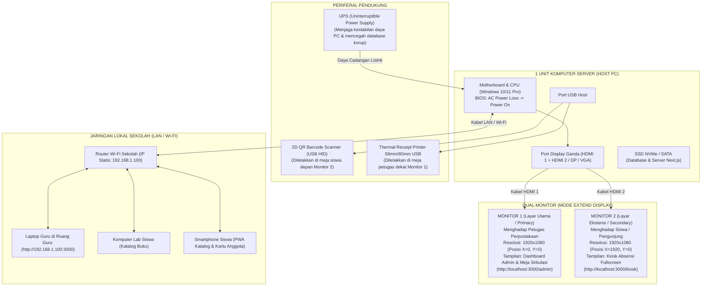

# Panduan Lengkap Server Windows & Setup 1 PC Dual-Monitor — Perpustakaan NETRI

Buku panduan operasional ini disusun agar dapat dijalankan kapan saja ketika aplikasi **Perpustakaan NETRI** siap dioperasikan (*deployment*) pada lingkungan produksi sekolah. Panduan ini mencakup skenario **1 Komputer dengan 2 Layar Monitor (Admin & Kiosk Absensi)** serta **pemulihan mandiri tanpa campur tangan manusia (*Zero-Touch Auto-Boot*)** saat terjadi pemadaman listrik.

---

## DAFTAR ISI
1. [Arsitektur Fisik & Topologi Perangkat](#1-arsitektur-fisik--topologi-perangkat)
2. [Checklist Kebutuhan Perangkat Keras & Lunak](#2-checklist-kebutuhan-perangkat-keras--lunak)
3. [Langkah 1: Pengaturan BIOS / UEFI (Otomatis Nyala Saat Listrik Masuk)](#langkah-1-pengaturan-bios--uefi-otomatis-nyala-saat-listrik-masuk)
4. [Langkah 2: Pengaturan 2 Monitor di Windows (Extend Mode)](#langkah-2-pengaturan-2-monitor-di-windows-extend-mode)
5. [Langkah 3: Pemasangan Database MySQL sebagai Windows Service](#langkah-3-pemasangan-database-mysql-sebagai-windows-service)
6. [Langkah 4: Pemasangan Server Next.js sebagai Windows Service (NSSM)](#langkah-4-pemasangan-server-nextjs-sebagai-windows-service-nssm)
7. [Langkah 5: Konfigurasi Windows Auto-Logon (Bypass Layar Kunci)](#langkah-5-konfigurasi-windows-auto-logon-bypass-layar-kunci)
8. [Langkah 6: Konfigurasi Skrip Peluncur Dual-Display Otomatis](#langkah-6-konfigurasi-skrip-peluncur-dual-display-otomatis)
9. [Langkah 7: Konfigurasi Akses Jaringan Lokal Sekolah (Wi-Fi / LAN)](#langkah-7-konfigurasi-akses-jaringan-lokal-sekolah-wi-fi--lan)
10. [Panduan Pemeliharaan & Pencadangan Data (Backup Otomatis)](#10-panduan-pemeliharaan--pencadangan-data-backup-otomatis)
11. [Troubleshooting & Pemecahan Masalah Umum](#11-troubleshooting--pemecahan-masalah-umum)

---

## 1. Arsitektur Fisik & Topologi Perangkat



---

## 2. Checklist Kebutuhan Perangkat Keras & Lunak

### Perangkat Keras (Hardware)
- [ ] **1 Unit PC Host:**
  - Prosesor: Minimal Intel Core i3 Gen 6 / AMD Ryzen 3 (Disarankan Core i5 / Ryzen 5).
  - RAM: Minimal 8 GB DDR4 (Disarankan 16 GB).
  - Penyimpanan: SSD minimal 256 GB (SSD sangat penting untuk kecepatan baca database & kompresi WebP).
  - Grafis: Mendukung minimal 2 keluaran video (misal: 1 HDMI + 1 DisplayPort / VGA).
- [ ] **2 Unit Monitor:**
  - Monitor 1 (Petugas): Layar kerja standar (19”–24”).
  - Monitor 2 (Siswa/Kiosk): Layar menghadap luar (21”–24”).
- [ ] **1 Unit 2D QR Barcode Scanner USB:**
  - Tipe *plug-and-play* USB HID Keyboard (dapat membaca kode QR dari layar HP maupun kartu cetak).
- [ ] **1 Unit Printer Thermal USB:**
  - Ukuran kertas 58mm atau 80mm untuk mencetak struk peminjaman / pengembalian.
- [ ] **1 Unit UPS (Uninterruptible Power Supply):**
  - Minimal 600VA / 360W untuk memberi jeda daya saat listrik PLN berkedip/mati mendadak.

### Perangkat Lunak (Software)
- [ ] **Windows 10 / 11 Pro 64-bit** (Versi Pro disarankan untuk pengelolaan Group Policy & Remote Desktop).
- [ ] **Node.js LTS (v20 atau v22)** terpasang dan terdaftar di `PATH`.
- [ ] **MySQL 8.0** (bisa menggunakan bawaan Laragon di `C:\laragon\bin\mysql\...` atau MySQL Community Server resmi).
- [ ] **Google Chrome** atau **Microsoft Edge** terbaru.
- [ ] **NSSM (Non-Sucking Service Manager)** versi 2.24 untuk Windows Service wrapper.

---

## 3. Langkah 1: Pengaturan BIOS / UEFI (Otomatis Nyala Saat Listrik Masuk)

> **Tujuan:** Ketika sekolah mengalami mati lampu dan listrik PLN menyala kembali, komputer server akan otomatis hidup sendiri tanpa perlu seseorang menekan tombol *Power*.

1. Matikan komputer.
2. Nyalakan komputer, lalu tekan tombol **`Delete`** atau **`F2`** (pada beberapa merek HP/Lenovo tekan `F1` atau `F10`) berkali-kali hingga masuk menu BIOS/UEFI.
3. Masuk ke tab **Power**, **Advanced**, **Power Management Setup**, atau **APM Configuration**.
4. Cari parameter bernama salah satu di bawah ini:
   - **`Restore on AC Power Loss`**
   - **`AC Back`**
   - **`State After Power Failure`**
   - **`After Power Loss`**
5. Ubah nilainya dari default (*Power Off*) menjadi **`Power On`** (atau **`Always On`**).
6. Tekan tombol **`F10`** $\rightarrow$ pilih **Save and Exit** $\rightarrow$ Komputer akan melakukan restart ke Windows.

---

## 4. Langkah 2: Pengaturan 2 Monitor di Windows (Extend Mode)

1. Tancapkan kedua kabel monitor ke port PC.
2. Masuk ke Windows, klik kanan pada area kosong di Desktop $\rightarrow$ pilih **Display settings**.
3. Pada bagian *Multiple displays*, ubah pilihan menjadi **"Extend these displays"** (Perluas tampilan ini).
4. Klik tombol **Identify** untuk mengetahui monitor mana yang bernomor 1 dan 2.
5. Susun posisi diagram layar di menu settings:
   - **Monitor 1 (Kiri):** Jadikan monitor utama dengan mencentang kotak **"Make this my main display"**.
   - **Monitor 2 (Kanan):** Geser posisinya persis sejajar di sebelah kanan Monitor 1.
6. Pastikan resolusi kedua layar disetel ke resolusi bawaan (Rekomendasi: `1920 x 1080`) dengan skala text (*Scale*) **`100%`**.

> [!NOTE]
> Dengan konfigurasi di atas:
> - Titik koordinat awal Monitor 1 adalah `X = 0, Y = 0`.
> - Titik koordinat awal Monitor 2 adalah `X = 1920, Y = 0` (sejajar di sebelah kanan Monitor 1).

---

## 5. Langkah 3: Pemasangan Database MySQL sebagai Windows Service

Agar database MySQL langsung aktif saat komputer mulai menyala tanpa harus membuka aplikasi Laragon secara manual:

1. Buka **Command Prompt** sebagai **Administrator** (Klik Start $\rightarrow$ ketik `cmd` $\rightarrow$ Klik kanan *Run as Administrator*).
2. Daftarkan service MySQL Laragon ke Windows Service:
   ```cmd
   cd C:\laragon\bin\mysql\mysql-8.0.30-winx64\bin
   mysqld.exe --install MySQL_Netri --defaults-file="C:\laragon\bin\mysql\mysql-8.0.30-winx64\my.ini"
   ```
3. Setel tipe startup menjadi otomatis dan jalankan servicenya:
   ```cmd
   sc config MySQL_Netri start= auto
   net start MySQL_Netri
   ```
4. Verifikasi bahwa database `perpus` sudah aktif dan siap menerima query.

---

## 6. Langkah 4: Pemasangan Server Next.js sebagai Windows Service (NSSM)

> **Mengapa menggunakan NSSM?**
> NSSM (*Non-Sucking Service Manager*) adalah standar industri untuk Windows yang membungkus aplikasi Node.js sebagai Windows Service murni. Jika aplikasi crash karena kendala memori, NSSM akan me-restart aplikasi secara otomatis dalam hitungan detik.

### A. Siapkan File Eksekusi NSSM
1. Unduh `nssm-2.24.zip` dari [https://nssm.cc/download](https://nssm.cc/download).
2. Buka arsip zip tersebut, masuk ke folder `win64`, lalu salin file `nssm.exe` ke folder sistem Windows:
   `C:\Windows\System32\nssm.exe`

### B. Lakukan Build Produksi Aplikasi
Buka terminal di direktori proyek:
```cmd
cd /d "e:\Web\Perputakaan New"
npm run build
```
*(Pastikan proses build selesai dengan sukses tanpa galat / return code 0).*

### C. Daftarkan Service Menggunakan Skrip Otomatis
Anda dapat menjalankan skrip pembantu yang telah disediakan:
```cmd
e:\Web\Perputakaan New\scripts\pasang-service-windows.bat
```
Atau daftarkan secara manual dengan perintah berikut (pada Command Prompt Administrator):
```cmd
nssm install NetriServer "C:\Program Files\nodejs\npm.cmd" "run start"
nssm set NetriServer AppDirectory "e:\Web\Perputakaan New"
nssm set NetriServer Description "Perpustakaan NETRI Next.js Production Web Server"
nssm set NetriServer Start SERVICE_AUTO_START
nssm set NetriServer AppStdout "e:\Web\Perputakaan New\server-out.log"
nssm set NetriServer AppStderr "e:\Web\Perputakaan New\server-err.log"
nssm start NetriServer
```

*Verifikasi:* Buka browser dan buka `http://localhost:3000`. Jika halaman Perpustakaan NETRI muncul, berarti server Next.js Anda sudah berjalan sebagai background service Windows!

---

## 7. Langkah 5: Konfigurasi Windows Auto-Logon (Bypass Layar Kunci)

Agar komputer langsung masuk ke Desktop Windows saat booting tanpa tertahan di layar login kata sandi:

### Cara Menggunakan Alat Resmi Microsoft (Paling Mudah & Aman)
1. Unduh **Autologon** dari Microsoft Sysinternals:
   [https://learn.microsoft.com/en-us/sysinternals/downloads/autologon](https://learn.microsoft.com/en-us/sysinternals/downloads/autologon)
2. Ekstrak dan jalankan `Autologon.exe` (Run as Administrator).
3. Masukkan kata sandi akun Windows yang sedang digunakan, lalu klik tombol **Enable**.
4. Selesai! Saat reboot, Windows akan otomatis masuk ke akun tersebut.

---

## 8. Langkah 6: Konfigurasi Skrip Peluncur Dual-Display Otomatis

Aplikasi menyediakan skrip peluncur khusus di [`scripts/netri-dual-display.bat`](file:///e:/Web/Perputakaan%20New/scripts/netri-dual-display.bat).

### Karakteristik Kunci Skrip Peluncur:
1. **Pemisahan Profil Browser (*User Data Directory*):**
   - Layar Admin menggunakan profil: `C:\netri-browser-profile\admin`
   - Layar Kiosk menggunakan profil: `C:\netri-browser-profile\kiosk`
   *Penting:* Jika profil tidak dipisahkan, Google Chrome akan menggabungkan tab ke dalam satu layar dan sesi login admin berisiko terbuka di layar siswa.
2. **Kiosk Mode Mandiri:**
   Monitor 2 dibuka dengan flag `--kiosk` sehingga tampilan siswa bersih tanpa address bar, tanpa tombol minimize/close, dan tidak bisa disalahgunakan oleh siswa untuk membuka tab lain.

### Memasang Skrip ke Windows Startup:
1. Tekan tombol kombinasi **`Win + R`** di keyboard.
2. Ketik **`shell:startup`** lalu tekan Enter. Jendela folder Startup Windows akan terbuka.
3. Di dalam folder tersebut, buat **Shortcut** baru yang mengarah ke file:
   `"e:\Web\Perputakaan New\scripts\netri-dual-display.bat"`
4. Beri nama shortcut tersebut: `Peluncur Perpustakaan NETRI`.

---

## 9. Langkah 7: Konfigurasi Akses Jaringan Lokal Sekolah (Wi-Fi / LAN)

Agar guru dan siswa dapat mengakses katalog dari komputer atau smartphone mereka:

### A. Tentukan IP Statis pada Komputer Server
1. Buka *Control Panel* $\rightarrow$ *Network and Sharing Center* $\rightarrow$ *Change adapter settings*.
2. Klik kanan kartu jaringan (Ethernet / Wi-Fi) $\rightarrow$ *Properties*.
3. Pilih *Internet Protocol Version 4 (TCP/IPv4)* $\rightarrow$ klik *Properties*.
4. Atur IP Statis, misalnya:
   - IP Address: `192.168.1.100`
   - Subnet Mask: `255.255.255.0`
   - Default Gateway: `192.168.1.1`
   - DNS: `8.8.8.8` / `1.1.1.1`

### B. Buka Port 3000 pada Windows Defender Firewall
Jalankan perintah ini di PowerShell (Run as Administrator):
```powershell
New-NetFirewallRule -DisplayName "Perpustakaan NETRI Server (Port 3000)" -Direction Inbound -LocalPort 3000 -Protocol TCP -Action Allow
```

Sekarang, siapa pun yang terhubung ke Wi-Fi sekolah dapat membuka katalog melalui:
`http://192.168.1.100:3000`

---

## 10. Panduan Pemeliharaan & Pencadangan Data (Backup Otomatis)

Untuk mencegah kehilangan data sirkulasi dan katalog buku, siapkan pencadangan otomatis harian menggunakan **Windows Task Scheduler**.

Buat file batch `scripts/backup-database.bat`:
```batch
@echo off
set TANGGAL=%date:~10,4%-%date:~4,2%-%date:~7,2%
set BACKUP_DIR=D:\Backup_Perpustakaan_NETRI
if not exist "%BACKUP_DIR%" mkdir "%BACKUP_DIR%"

echo Memulai pencadangan database perpus...
"C:\laragon\bin\mysql\mysql-8.0.30-winx64\bin\mysqldump.exe" -u perpus_app -pKatasandiKuat123! perpus > "%BACKUP_DIR%\perpus_%TANGGAL%.sql"

echo Pencadangan selesai: %BACKUP_DIR%\perpus_%TANGGAL%.sql
```

Daftarkan skrip di atas pada **Task Scheduler** Windows agar berjalan setiap hari pada pukul **17:00** (setelah jam tutup perpustakaan).

---

## 11. Troubleshooting & Pemecahan Masalah Umum

### Q1: Jendela Kiosk Muncul di Monitor Admin (Layar Tertukar)
- **Penyebab:** Urutan monitor Windows terbalik (Monitor 1 berada di kanan bukan di kiri).
- **Solusi:**
  1. Buka *Display settings* di Windows.
  2. Klik dan seret kotak monitor nomor 2 ke sebelah kanan monitor nomor 1.
  3. Pastikan Monitor 1 dicentang sebagai *"Make this my main display"*.
  4. Jika resolusi monitor 1 bukan 1920x1080 (misal 1366x768), ubah nilai `--window-position=1920,0` pada file `scripts/netri-dual-display.bat` menjadi `--window-position=1366,0`.

### Q2: Siswa Menekan Tombol di Layar Kiosk dan Menutup Tampilan
- **Penyebab:** Menggunakan mode jendela biasa (*windowed*), bukan mode Kiosk.
- **Solusi:** Pastikan skrip `netri-dual-display.bat` menggunakan parameter `--kiosk`. Mode ini menonaktifkan tombol silang (X), address bar, dan tombol F11. Untuk menutup mode kiosk saat pemeliharaan, petugas dapat menekan kombinasi tombol **`Alt + F4`**.

### Q3: Alat Barcode Scanner Mengetik Angka Ganda atau Lambat
- **Penyebab:** Konfigurasi inter-character delay pada alat scanner atau driver keyboard.
- **Solusi:** Scanner QR modern bekerja sebagai keyboard USB (HID). Pastikan kursor aktif pada kolom pencarian atau biarkan kamera aktif. Pada halaman `/kiosk`, sistem Perpustakaan NETRI memiliki fitur *auto-capture* yang langsung mendeteksi input string QR berawalan `PUS1:A:` secara otomatis tanpa harus mengklik kolom teks terlebih dahulu.

### Q4: Listrik Padam dan Database Mengalami Galat "Table Corrupted"
- **Penyebab:** Komputer mati mendadak saat MySQL sedang menulis data ke disk.
- **Pencegahan Utama:** **Wajib gunakan UPS (Uninterruptible Power Supply)**.
- **Pemulihan Cepat:** Buka Command Prompt (Admin) lalu jalankan:
  ```cmd
  "C:\laragon\bin\mysql\mysql-8.0.30-winx64\bin\mysqlcheck.exe" -u root --auto-repair --check --all-databases
  ```
